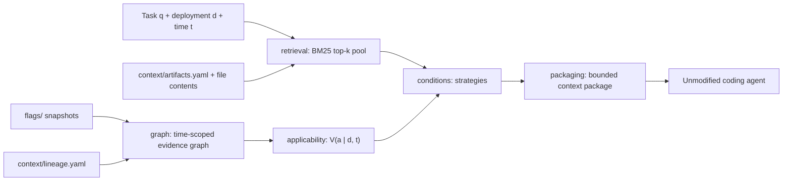

# Architecture

## Modules and packages

| Module | Purpose |
|---|---|
| `merchant-service` | The system under change: legacy REST and GraphQL trust score, routed by flags (`TrustScoreRouter`). |
| `feature-flags` | Flag snapshot repository and evaluator shared by the target system and CASE; `GET /flags`. |
| `case-context-layer` | CASE. Packages: `model`, `retrieval`, `graph`, `applicability`, `packaging`, `conditions`, `pilot`, `api`. |

## Paper to code

| Paper | Code |
|---|---|
| Relevance R(a, q), Fig. 2 "retrieve" | `retrieval.Bm25Retriever` |
| Step 1: link evidence (guards, deployed-in, supersedes) | `graph.EvidenceGraphBuilder`, `graph.Lineage`, `feature-flags` |
| Eq. (1) V(a \| d, t) | `applicability.ApplicabilityEvaluator` |
| Step 3: bounded package, ACT ON / EXPLAIN / VERIFY | `conditions.CaseValidityStrategy`, `packaging.*` |
| RQ2 four conditions | `conditions.*Strategy`, `conditions.CaseStrategies` |
| RQ1 labelling and agreement | `pilot.PilotRunner` (pool export), `pilot.AnnotationAnalyzer`, `pilot/annotation-schema.md` |
| RQ3 ablations, replay probe | `Condition.CASE_NO_*`, `graph.Ablation`, `pilot.PilotRunner` probe |
| Agent run protocol | `experiments/agent-demo/` |

## Design choices
- Only evidence timestamped at or before `t` is used, for artifacts and for flags.
- Cohort-scoped, non-authoritative or missing evidence is UNKNOWN, never silently false.
- One shared candidate pool and one budget B for every condition; tokens are approximated as characters / 4.
