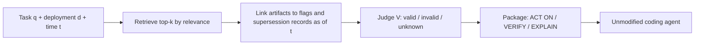

# How this repository supports the paper

A guided tour from the paper "When Relevant Code Is Wrong: Runtime-Aware Context for AI Coding Agents" to the code in
this repository. Each layer goes one level deeper; stop reading whenever you have what you need. All data is
synthetic.

| Layer | Read it if you want |
|---|---|
| [0. The short answer](#0-the-short-answer) | One paragraph |
| [1. The idea in plain words](#1-the-idea-in-plain-words) | The concepts, without code |
| [2. The story the repository tells](#2-the-story-the-repository-tells) | The concrete scenario and its traps |
| [3. Paper section to code](#3-paper-section-to-code) | Where every claim lives in the code |
| [4. What the frozen pilot shows](#4-what-the-frozen-pilot-shows) | The numbers and how to read them |
| [5. Honest limits](#5-honest-limits) | What this repository does not prove |
| [6. Try it in five minutes](#6-try-it-in-five-minutes) | Commands to reproduce everything |

## 0. The short answer

The paper argues that a retrieved artifact can be relevant to a task and still be the wrong thing to copy, because
the deployment it targets has moved on. It proposes CASE, a context layer that labels each artifact `VALID`,
`INVALID` or `UNKNOWN` for a given deployment and time, and hands a coding agent a bounded, source-backed package.
This repository is the paper's synthetic replay example. It contains a small system that reproduces the failure
(`merchant-service`), a minimal CASE layer that addresses it (`case-context-layer`), and a pilot harness that
exercises the paper's research questions RQ1 to RQ3 (`pilot/`, `experiments/`).

## 1. The idea in plain words

**The motivating problem.** In an industrially motivated case from a large online marketplace, a coding agent was given
a thorough, well-written requirement to extend a seller-quality signal. It produced a clean change, but in the legacy
REST flow. The team had already moved that feature to GraphQL. The REST code was well documented, tested and
topically perfect, and it was the wrong place to make the change. The agent only got it right once the prompt was
manually nudged towards GraphQL. What the agent lacked was the runtime picture: which feature flags are on, in which
deployment, as of when.

**Two different questions about an artifact.**

| Question | Paper notation | Answered by |
|---|---|---|
| Is this artifact about my task? | Topical relevance R(a, q) | Ordinary retrieval (here BM25) |
| Does this artifact apply to my target deployment right now? | Operational validity V(a \| d, t) | CASE's applicability evaluator |

**Three labels, never two.**

- `VALID`: authoritative evidence says this artifact's runtime path is live for deployment d at time t.
- `INVALID`: authoritative evidence says it is off or superseded there.
- `UNKNOWN`: the evidence is missing, partial (for example only for a cohort) or contradictory. Unknown is never quietly
  treated as invalid.

**Three package sections.** The agent receives the same artifacts it would have retrieved anyway, sorted by role:

- ACT ON: valid artifacts the agent may implement against.
- VERIFY: unknowns, each with an explicit question to resolve before relying on them.
- EXPLAIN: invalid or purely explanatory artifacts, kept as labeled history and never used as a blueprint.



## 2. The story the repository tells

The system serves a merchant trust score through two paths: a legacy REST endpoint and a newer GraphQL resolver with
pluggable signals. Feature flags, per deployment and over time, decide which one is live.

**Timeline** (full version with file pointers in [walkthrough.md](walkthrough.md#1-the-history-the-agent-can-see)):

| Date | Event |
|---|---|
| 2024-11-10 | REST trust-score endpoint added (PR-101) |
| 2025-12-01 | ADR-007: move to GraphQL, deployment by deployment |
| 2026-01-12 | GraphQL trust score with pluggable signals (PR-214) |
| 2026-01-15 | `us-prod` switches to GraphQL |
| 2026-01-20 | `eu-prod` switches to GraphQL |
| 2026-02-01 | `apac-prod` enables GraphQL for an unverified cohort only |
| 2026-04-02 | `eu-prod` rolls back to REST (PR-231) |
| 2026-05-20 | Experimental return-rate signal, flag off everywhere (PR-245) |

**State on 2026-06-01:**

| Deployment | REST | GraphQL |
|---|---|---|
| `us-prod` | INVALID | VALID |
| `eu-prod` | VALID (after rollback) | INVALID |
| `apac-prod` | VALID | UNKNOWN (cohort only, unverified) |

**The three traps the paper describes, and where they appear here:**

1. **Old code can still be the right code.** The `eu-prod` rollback is the paper's "regional rollback"
   counterexample: the same REST endpoint is invalid in `us-prod` and valid in `eu-prod` at the same moment. A rule
   like "prefer newer files" gets `eu-prod` wrong.
2. **The newest change can be dormant.** PR-245 is the most recent trust-signal PR, but its flag is off everywhere.
   Recency filtering promotes it anyway.
3. **Partial evidence is not a verdict.** In `apac-prod` GraphQL is on only for the `beta-merchants` cohort, and the
   assignment is unverified ([flags/apac-prod/2026-02-01.yaml](../flags/apac-prod/2026-02-01.yaml)). CASE puts the
   GraphQL artifacts under VERIFY instead of guessing either way.

The task used throughout is "Extend the merchant trust score with a new return rate signal". For `us-prod` the correct
change is a new `TrustSignalProvider` bean on the GraphQL path; for `eu-prod` it is the REST formula. Both reference
solutions are checked in: [us-prod-graphql.patch](../experiments/agent-demo/reference-solutions/us-prod-graphql.patch)
and [eu-prod-rest.patch](../experiments/agent-demo/reference-solutions/eu-prod-rest.patch).

## 3. Paper section to code

Paths below are relative to the repository root. `case-context-layer` classes live under
`case-context-layer/src/main/java/dev/caseresearch/caselayer/`.

### Section I: the motivating scenario

| Paper claim | Code |
|---|---|
| A REST path and a newer GraphQL path for the same domain concept | `merchant-service/.../rest/` and `merchant-service/.../graphql/` |
| Which path is live depends on flags, deployment and time | `merchant-service/.../TrustScoreRouter.java` (checks `trust-score.graphql.enabled`, then `trust-score.rest.enabled`, then the guarded fallback) |
| Well-documented, tested historical artifacts | `history/prs/`, `history/adr/ADR-007-graphql.md`, `history/migration-note-rest-to-graphql.md`, tests in `merchant-service/src/test/` |
| Runtime behavior is real, not just documented | `UsProdRoutingTest`, `EuProdRoutingTest`, `ApacProdCohortTest` in `merchant-service/src/test/` |

### Section II: operational context validity, Eq. (1)

| Paper concept | Code |
|---|---|
| Task q, deployment d, snapshot t | `model/TaskRequest.java` (`task`, `deployment`, `asOf`) |
| Artifact a | An entry in [context/artifacts.yaml](../context/artifacts.yaml), loaded as `model/Artifact.java` |
| Preconditions π_a | The artifact's `implementation` mapped to `requiresFlag` in [context/lineage.yaml](../context/lineage.yaml), plus its supersession records |
| Timestamped evidence E_t | Flag snapshots in `flags/<deployment>/<date>.yaml` and lineage records, restricted to time t or earlier (`graph/EvidenceGraph.java`, `model/Evidence.java`) |
| V(a \| d, t) with three outcomes | `applicability/ApplicabilityEvaluator.java` returning `model/Applicability` |
| Source authority matters | A snapshot whose `authority` is not `AUTHORITATIVE` makes every flag unknown (`feature-flags/.../FlagEvaluator.java`, `Tri.java`) |
| Absence of traces is not evidence of invalidity | There is deliberately no telemetry input to the evaluator |
| Prescriptive vs explanatory roles | `role` in `artifacts.yaml` (`model/ArtifactRole.java`) |

The evaluator's rules, in order (see the class Javadoc):

1. Guard flag authoritatively off: `INVALID`.
2. Guard flag on and no active supersession: `VALID`. On but a supersession is active: conflict, so `UNKNOWN`.
3. Guard flag not established (cohort-scoped, missing, non-authoritative): `INVALID` only if a supersession is
   active, otherwise `UNKNOWN`.
4. Artifacts with `implementation: none` were expert-reviewed as deployment-independent and are `VALID`.

**Table I of the paper, made concrete:**

| Paper row | Artifact in this repository | What CASE does with it |
|---|---|---|
| Old REST route: invalid | `code-rest-service`, `code-rest-controller`, `pr-101-rest` in `us-prod` | EXPLAIN, labeled `INVALID` (REST flag off) |
| GraphQL resolver: valid | `code-aggregator`, `test-graphql`, `pr-214-graphql` in `us-prod` | ACT ON, with the flag snapshot as evidence |
| Guarded fallback: unknown | `code-fallback` in `apac-prod` (fallback flag is cohort-scoped and unverified). It never ranks into a frozen pool, so the same rule is shown on the GraphQL artifacts in `t4` | VERIFY, with an obligation to confirm the cohort |
| Migration note: historical rationale | `migration-note`, `adr-007`, `pr-231-eu-rollback` (role `EXPLANATORY`) | EXPLAIN, "historical rationale, not a blueprint" |

### Section III: a minimal CASE context layer

| Paper step | Code |
|---|---|
| Retrieval pool by relevance R(a, q) | `retrieval/Bm25Retriever.java` over `retrieval/ArtifactCatalog.java`; only artifacts existing at t |
| Step 1: link evidence with guards, deployed-in and supersedes edges | `graph/EvidenceGraphBuilder.java`, `graph/Lineage.java`, the `feature-flags` module |
| Step 1: links come from a small expert-reviewed lookup | `context/lineage.yaml` and the `implementation` field in `artifacts.yaml` |
| Step 2: adjudicate applicability with provenance | `applicability/ApplicabilityEvaluator.java` producing `model/Judgment.java` |
| Step 3: bounded package P_B(q, d, t) under budget B | `packaging/Packer.java`, `packaging/ContextPackage.java`, `packaging/SectionKind.java` (`ACT_ON`, `VERIFY`, `EXPLAIN`) |
| Each claim carries pointer, scope, timestamp, status | `packaging/Claim.java`; visible in every package as `Evidence: <file> @ <time> \| scope=... \| authority=...` |
| Delivered to an existing agent through its normal context | `scripts/case-context.sh` writes `AGENT_CONTEXT.md`; `AGENTS.md` and `.cursor/rules/case-context.mdc` tell the agent to read it |
| Decision policy: never copy invalid code, ask about unknowns, stop if nothing is valid | Steps 3 and 4 of [AGENTS.md](../AGENTS.md) |
| Also available as a service | `api/ContextController.java` (`POST /context-packages`) and `api/CaseCli.java` |

### Section IV: the falsifiable pilot

| Paper element | Code |
|---|---|
| Strata: migration, flag/region variation, stable controls | Six tasks in `pilot/tasks/`: `t1`, `t2` migration; `t3`, `t4` flag-region; `t5`, `t6` stable |
| Each task pinned to a deployment d and time t; oracles withheld | `deployment` and `asOf` in each task file; oracles in `pilot/oracles/` are never passed to a strategy |
| RQ1: does relevance diverge from validity? | `pilot/PilotRunner.java` writes `pool.csv` per task for two annotators; `pilot/AnnotationAnalyzer.java` computes precision@k, incompatible@k and Cohen's kappa; instructions in [pilot/annotation-schema.md](../pilot/annotation-schema.md) |
| RQ2: four conditions, same pool and same budget | `conditions/SemanticOnlyStrategy`, `RecencyFilteredStrategy` (180-day window), `SemanticPlusRawConfigStrategy` (raw flags, unadjudicated), `CaseValidityStrategy` |
| RQ2: the "just append configuration" competing baseline | `SEMANTIC_PLUS_RAW_CONFIG` |
| RQ3: ablate flag evidence and supersession evidence separately | `CASE_NO_FLAG_EVIDENCE`, `CASE_NO_LINEAGE_EVIDENCE` (`graph/Ablation.java`) |
| RQ3: replay the same task under two deployments | `replayDeployment` in `t1` and `t3`; the probe in `PilotRunner` checks that ACT ON changes |
| Blind evaluation of agent plans | [experiments/agent-demo/protocol.md](../experiments/agent-demo/protocol.md), `make-prompts.sh` (randomized run order), `results-template.csv` |
| Reproducibility: publish schema, recipes and a synthetic replay | This repository; `scripts/check-results.sh` regenerates the pilot and fails on any drift |

Metric definitions are in [metrics.md](metrics.md).

## 4. What the frozen pilot shows

From [pilot/results/summary.md](../pilot/results/summary.md). "Actionable" means what a package offers as something to
copy: the ACT ON section for CASE, everything for the baselines.

| Condition | Mean valid precision | Mean valid recall | Incompatible actionable (total) | Unknown actionable (total) |
|---|---|---|---|---|
| SEMANTIC_ONLY | 0.50 | 1.00 | 16 | 5 |
| RECENCY_FILTERED | 0.43 | 0.43 | 6 | 5 |
| SEMANTIC_PLUS_RAW_CONFIG | 0.50 | 1.00 | 16 | 5 |
| CASE_VALIDITY_PACKAGE | 1.00 | 1.00 | 0 | 0 |
| CASE_NO_FLAG_EVIDENCE | 0.33 | 0.13 | 0 | 0 |
| CASE_NO_LINEAGE_EVIDENCE | 1.00 | 1.00 | 0 | 0 |

**How to read it, in the paper's terms:**

- **Relevance diverges from validity (RQ1 premise).** Similarity retrieval finds every applicable artifact (recall
  1.00) but half of what it offers is wrong for the target deployment: 16 incompatible items across six tasks.
- **Recency is not the fix.** In `t3` (`eu-prod` after the rollback) recency keeps the four newest artifacts and all
  four are incompatible.
- **More runtime data is not the same as adjudicated runtime data.** Adding the raw flag snapshot changes nothing in
  what is offered as actionable. This is the competing baseline the paper singles out; whether an agent can infer the
  right path from it on its own is exactly what the agent protocol is for.
- **Flag evidence carries the load (RQ3).** Without it, almost everything becomes unknown and recall drops to 0.13.
  Removing lineage costs nothing here because flags already decide every case; the repository states this openly.
- **Stable controls are preserved.** On `t5` and `t6`, which no migration touches, CASE still offers the right
  artifacts.
- **The replay probe passes.** The same task and repository state give REST under `eu-prod` and GraphQL under
  `us-prod`:

```
t3, eu-prod: ACT ON = [code-rest-controller, code-rest-service, pr-101-rest, test-rest]
t3, us-prod: ACT ON = [code-aggregator, pr-214-graphql, test-graphql]
```

**Side by side for `t3` (`eu-prod`, 2026-06-01).** Similarity retrieval offers a flat list that mixes PR-214
(GraphQL, disabled here), PR-101 (REST, live here) and PR-245 (experiment, off). CASE offers the same pool, sorted:

```
ACT ON  [VALID]   PR-101, LegacyTrustScoreService, its test, LegacyTrustScoreController
        Evidence: flags/eu-prod/2026-04-02.yaml (trust-score.rest.enabled on for all traffic)
                  history/prs/PR-231-eu-rollback.md (supersession by GraphQL reverted in eu-prod)
EXPLAIN [INVALID] PR-214, TrustSignalAggregator and its test   (trust-score.graphql.enabled off)
        [INVALID] PR-245                                       (experiment flag off)
```

Full outputs: [semantic_only.md](../pilot/results/t3-flag-eu-after-rollback/semantic_only.md) and
[case_validity_package.md](../pilot/results/t3-flag-eu-after-rollback/case_validity_package.md).

## 5. Honest limits

These mirror Section V of the paper and support its stance of "plausibility, not effectiveness".

- **Synthetic and small:** 15 artifacts, 3 deployments, 6 tasks, against the paper's planned 24 real tasks.
- **CASE's precision is high by construction.** The oracles are written from the same rules the evaluator implements.
  The informative signals are the baselines' failures, the ablation costs and the replay probe.
- **Lineage is redundant in this fixture**, so its ablation shows no effect.
- **Links are curated by hand**, as the paper proposes for the pilot; nothing here recovers them automatically.
- **BM25 is a simple lexical retriever**, and tokens are approximated as characters / 4.
- **No agent runs are bundled.** The kit lets you run them; the primary outcome of the paper (operational
  compatibility violations in agent plans) needs those runs.

## 6. Try it in five minutes

```bash
./mvnw verify                                   # build and run every test (Java 17+)

# Same task, two deployments: compare ACT ON in the two outputs
scripts/case-context.sh "Extend the merchant trust score with a new return rate signal" eu-prod 2026-06-01T00:00:00Z
scripts/case-context.sh "Extend the merchant trust score with a new return rate signal" us-prod 2026-06-01T00:00:00Z

scripts/run-pilot.sh                            # all tasks x all conditions -> pilot/out/
scripts/check-results.sh                        # confirms the frozen results reproduce
```

Then give the same task to a coding agent with and without `AGENT_CONTEXT.md`, following
[experiments/agent-demo/protocol.md](../experiments/agent-demo/protocol.md).

**Where to go next:**

| Document | For |
|---|---|
| [walkthrough.md](walkthrough.md) | The failure mode step by step |
| [architecture.md](architecture.md) | Modules and design choices |
| [metrics.md](metrics.md) | Exact metric definitions |
| [reference.md](reference.md) | Scripts, properties, HTTP endpoints, glossary |
| [data-formats.md](data-formats.md) | File formats and how to add deployments, artifacts and tasks |
